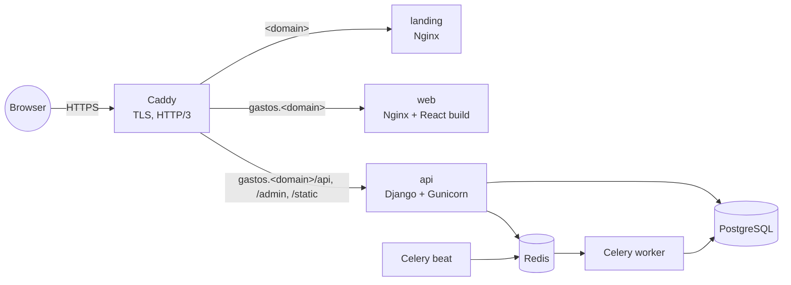
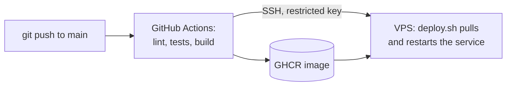

# Portfolio infrastructure

How my portfolio runs in production: one small VPS, Docker Compose, Caddy for automatic HTTPS,
and continuous deployment from GitHub Actions. Every app repo builds and publishes its own image;
this repo only says how they run together.

| URL | What | Repo |
|---|---|---|
| `https://<domain>` | Landing page | [portfolio-site](https://github.com/SEDEBE/portfolio-site) |
| `https://gastos.<domain>` | Expense tracker (React app) | [expense-tracker-web](https://github.com/SEDEBE/expense-tracker-web) |
| `https://gastos.<domain>/api/` | Expense tracker API (Django) | [expense-tracker-api](https://github.com/SEDEBE/expense-tracker-api) |

## Run everything locally

With the four repos cloned side by side in one folder (`expense-tracker-api`,
`expense-tracker-web`, `portfolio-site`, `portfolio-infra`), Docker and Node 24:

```bash
cd portfolio-infra
make dev      # API in Docker + app and landing with Vite (hot reload); Ctrl+C to stop them
make stop     # also stop the API containers (make down works too)
make help     # other commands (create or change an admin user...)
```

| URL | What |
|---|---|
| http://localhost:5174 | Landing |
| http://localhost:5173 | Expense tracker app |
| http://localhost:8000/api/docs/ | API docs (Swagger) |
| http://localhost:8000/admin/ | Django admin |
| http://localhost:8025 | Emails sent locally (Mailpit) |

## Architecture





- Images are public on GHCR (`ghcr.io/sedebe/...`), so the server pulls them without credentials.
- **Caddy** gets and renews Let's Encrypt certificates by itself and redirects HTTP to HTTPS.
- The React app and its API share one origin (`gastos.<domain>`), so the browser makes no
  cross-origin requests.
- Only ports 22, 80 and 443 are open. Postgres and Redis are only reachable inside Docker's network.
- The CI deploy key is limited by `scripts/ci-deploy.sh`: it can only run `deploy.sh` with a
  known service name, never open a shell.

## Files

```
compose.yml               the production stack (pulls images from GHCR)
Caddyfile                 sites, routing and security headers
deploy.sh                 pull and restart some services (used by CI)
scripts/setup-server.sh   first-time hardening of a fresh Ubuntu 24.04 server
scripts/ci-deploy.sh      forced command for the CI deploy key
scripts/backup.sh         nightly pg_dump, keeps 14 days
systemd/                  timer and service that run the backup
.env.example              settings and secrets to fill in on the server
```

## First deployment

1. **Server**: create an Ubuntu 24.04 VPS (2 GB RAM is enough) with your SSH key, then harden it:
   ```bash
   ssh root@SERVER_IP 'bash -s' < scripts/setup-server.sh
   ssh deploy@SERVER_IP        # in a NEW terminal, before closing the root one
   ```
2. **DNS**: at your domain registrar, create `A` records for `@`, `www` and `gastos` pointing to
   the server's IP (and `AAAA` records if it has IPv6).
3. **Stack**, as `deploy` on the server:
   ```bash
   git clone https://github.com/SEDEBE/portfolio-infra.git && cd portfolio-infra
   cp .env.example .env && chmod 600 .env && nano .env     # domain, email, secrets
   docker compose up -d
   docker compose ps                                        # everything "healthy"
   docker compose exec api python manage.py createsuperuser
   ```
4. **Backups**:
   ```bash
   sudo cp systemd/portfolio-backup.* /etc/systemd/system/
   sudo systemctl daemon-reload && sudo systemctl enable --now portfolio-backup.timer
   systemctl list-timers portfolio-backup.timer
   ```
5. **Email** with [Resend](https://resend.com): add the domain (region eu-west-1) and create its DNS
   records (DKIM `TXT`, the two `CNAME`s for sending, `_dmarc` `TXT`). Once it shows *Verified*,
   create a *Sending access* API key and store it without echoing it:
   ```bash
   read -rsp "Resend API key: " K && echo && sed -i "s|^EMAIL_URL=.*|EMAIL_URL=smtp+tls://resend:$K@smtp.resend.com:587|" .env
   docker compose up -d api worker beat
   docker compose exec api python manage.py sendtestemail you@example.com
   ```
6. **Continuous deployment**: create a key used only by CI and restrict it on the server.
   ```bash
   # On your computer
   ssh-keygen -t ed25519 -N "" -C github-actions-deploy -f ~/.ssh/portfolio_deploy
   # On the server, append ONE line to ~/.ssh/authorized_keys (paste your .pub content):
   command="/home/deploy/portfolio-infra/scripts/ci-deploy.sh",no-pty,no-port-forwarding,no-agent-forwarding,no-X11-forwarding ssh-ed25519 AAAA... github-actions-deploy
   ```
   In each app repo (api, web, site) → Settings → Secrets and variables → Actions:
   variables `DEPLOY_HOST` (server IP) and `DEPLOY_USER` (`deploy`), secret `DEPLOY_SSH_KEY`
   (content of `~/.ssh/portfolio_deploy`). The next push to `main` deploys by itself.

## Day to day

```bash
docker compose ps                          # status
docker compose logs -f api worker          # logs
./deploy.sh web                            # deploy the latest image of one service by hand
scripts/backup.sh                          # backup now
gunzip -c backups/<file>.sql.gz | docker compose exec -T db sh -c 'psql -U "$POSTGRES_USER" "$POSTGRES_DB"'   # restore
```
